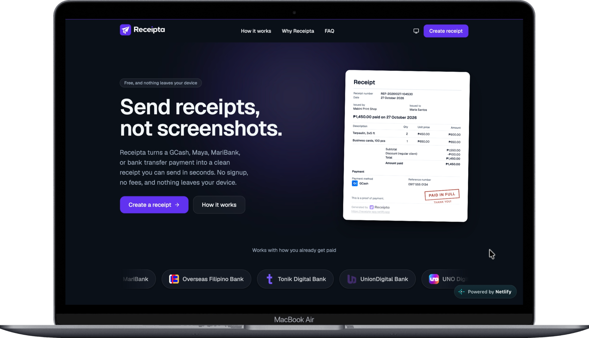
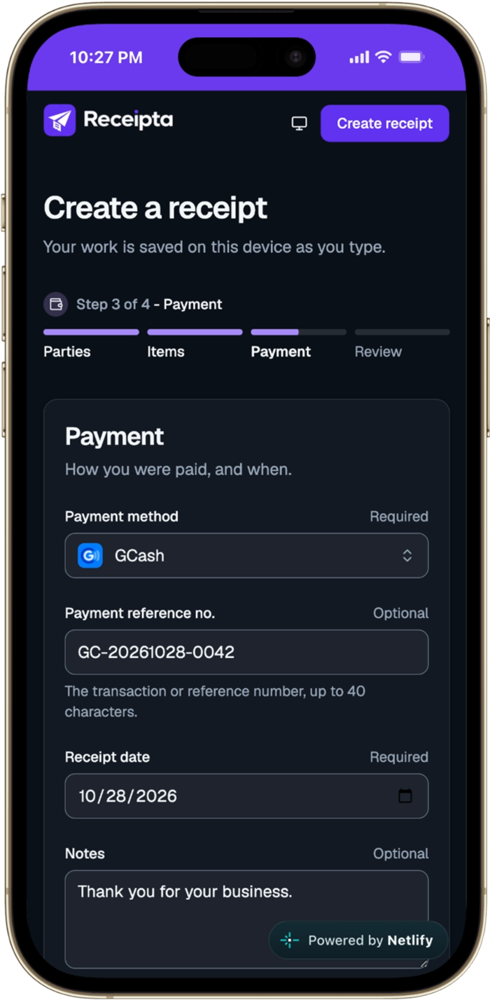
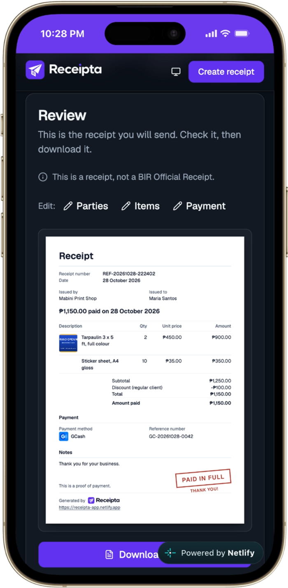

# Receipta

**Send receipts, not screenshots.**

Turn a GCash, Maya, or bank transfer into a clean receipt you can send in seconds — then download it as a PDF or an image.

Everything happens in your browser. There is no account, no server, and nothing to upload.

**[receipta-app.netlify.app](https://receipta-app.netlify.app)**

---

<p align="center">
  
</p>

<p align="center">
  
  
  
</p>

---

## Why it exists

People who get paid through GCash, Maya or a bank transfer send a screenshot of the payment
when a customer asks for a receipt. A screenshot shows the sender's balance, their recent
transactions, and whatever notification happened to be on screen — and it does not say what
was bought.

Receipta makes the receipt instead: who paid, what for, how much, and how it arrived.

## What it does

- **A four-step builder** — parties, items, payment, review — with the form state kept in one place so going back loses nothing.
- **Individual or Organization** for either party.
- **Multiple items**, each with an optional photo.
- **One payment method per receipt**, picked from 31 Philippine banks, digital banks and e-wallets, each with its own logo.
- **An optional discount**, which can say what it was for: `Discount (regular client)`.
- **PDF and PNG export**, on white paper in both themes, with automatic pagination.
- **A draft that survives a refresh**, saved in your browser and clearable at any time.

### What it is not

**A Receipta receipt is a proof of payment, not a BIR Official Receipt.** An official receipt
has registration, numbering and retention requirements this tool does not meet. The document
says so, on every page.

## Privacy

There is no backend. The receipt you build lives in your browser's local storage and is never
sent anywhere, because there is nowhere to send it:

- Institution logos and fonts are served from this app, never from a third party.
- The Content-Security-Policy is `default-src 'self'` with no third-party origin allowed, so
  a dependency that started phoning home would be blocked rather than quietly doing it.
- No analytics, no cookies, no tracking.

## Tech stack

| Concern | Choice |
| --- | --- |
| Framework | React 19 |
| Routing | TanStack Router |
| Forms | TanStack Form |
| Language | TypeScript |
| Styling | Tailwind CSS v4 |
| UI components | shadcn/ui |
| Icons | react-icons |
| Toasts | react-hot-toast |
| Export | html2canvas-pro + jsPDF, loaded on first use |
| Build tool | Vite |
| Testing | Vitest + React Testing Library |
| Hosting | Netlify |
| Architecture | [Feature Sliced Design v1](https://feature-sliced.design/) |

## Getting started

Requires Node.js 22 and npm.

```bash
npm install
npm run dev
```

## Scripts

```bash
npm run dev          # Start the dev server
npm run build        # Type-check and build for production
npm run lint         # Lint with ESLint
npm test             # Run the tests once
npm run test:watch   # Run the tests in watch mode
```

`npm run build` is `tsc -b && vite build`, so a type error fails the build rather than
shipping. Note that `npm test` does **not** type-check — several bugs here have been caught
by the build after a green test run.

## Architecture

Feature Sliced Design, with the usual rule: a layer may import from the layers below it and
never from a layer above or beside it.

```
src/
  app/        router, routes, root layout
  pages/      home, create, legal
  widgets/    hero, steps, FAQ, header, footer
  features/   receipt_form, receipt_export, theme_switcher
  entities/   receipt — the document, its view model, and its money
  shared/     ui primitives, config, lib
```

The receipt document lives in `entities/receipt` because two features render it: the form's
preview and the export. They are the same component with the same view model, so the preview
cannot show something the file will not.

### Conventions

File names are `snake_case`; component identifiers are `PascalCase`, because JSX treats a
lowercase tag as an HTML element. Hooks are `camelCase`, because React's lint rule only
recognises a hook when its name is `use` followed by a capital. Colours live only in
`index.css`. Money is formatted only with `Intl.NumberFormat('en-PH')`, and money math is
unit-tested without exception.

`src/test/repo_rules.test.ts` enforces most of this by reading the TypeScript syntax tree, so
the conventions are checks rather than documentation.

## Testing

```bash
npm test
```

Over 1,100 tests. The ones worth knowing about:

- **Money is integer arithmetic** — centavos for price, thousandths for quantity. Each line
  rounds half-up once, then lines are summed, then the discount is subtracted, so the printed
  lines always add up to the printed subtotal.
- **Pagination is a pure function** over measured row heights, fuzzed over 200,000 inputs: a
  row is never split, and the totals always travel with the last item row.
- **The exported receipt is white in both themes**, verified by rendering it light and dark
  and comparing the PNGs byte for byte.
- **No wrong file is ever handed over** — a null blob, a blank canvas or a transparent one is
  refused rather than saved.

## Deployment

Netlify, configured in `netlify.toml`: every path serves `index.html` so a shared link does
not 404, `/assets` is cached forever and the entry point is not, and the CSP carries a hash
of the one inline script — the theme guard that runs before first paint.

## Documentation

`docs/specs/` holds a folder per feature: what it had to do, how it was built, and what was
measured. They record the decisions and the things that turned out to be wrong, which is
usually the more useful half.
